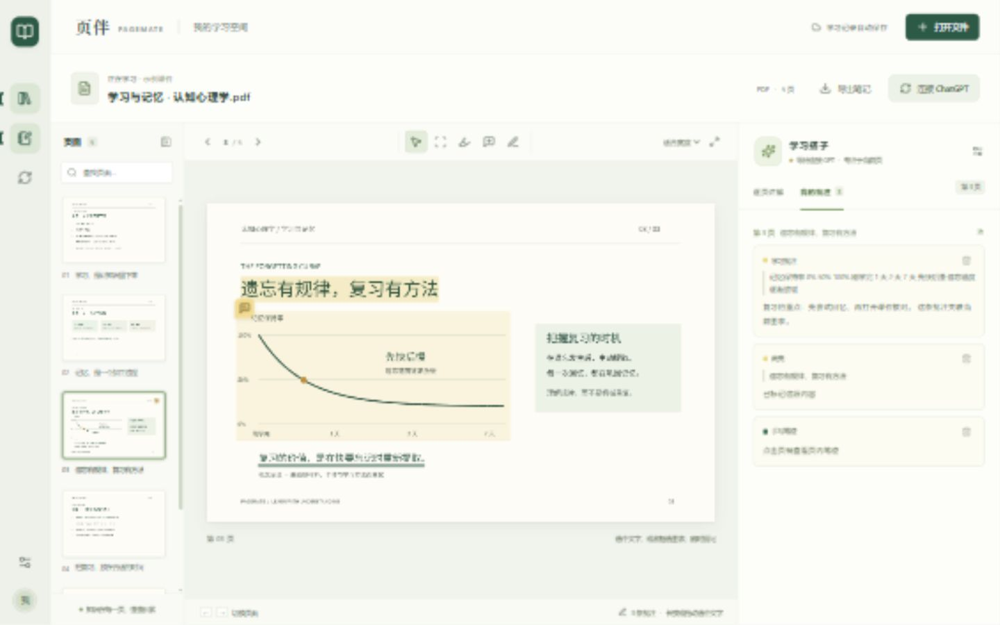

# 页伴 PageMate

在 PDF / PPT 旁，逐页提问、框选图表、听讲解，并把理解留成批注。面向 Windows 和安卓平板的可安装网页应用（PWA），单人自托管。



## 现在能做什么

- 导入 PDF、PPT、PPTX；保留课件静态排版。每个文件最多 100 MB / 1500 页。
- 每页有独立对话；GPT 结合该页文字与截图流式讲解，支持连续追问和停止生成。
- 原生文字选择、图表框选、选区提问；扫描 PDF 通过截图交给视觉模型理解。
- 文字高亮、触控笔/手指书写、文字批注；GPT 在明确要求下调用工具写入当前页批注。
- 把讲解一键保存为批注，按页查看和删除批注。
- 导出带高亮、笔迹与 PDF 评论的 PDF；导出完整 Markdown 学习记录。
- 浏览器朗读已生成的讲解（使用设备语音，效果取决于系统语音包）。
- Windows 与安卓访问同一服务，共享文件、问答和批注；12 秒轮询更新其他设备的已保存内容。
- ChatGPT 续学：复制本页记录、整份 Markdown 上传；提供经过协议测试的只读 MCP 服务，配置后让 ChatGPT 按需读取学习库。

## 为什么选择 PWA

平板无需安装 APK，Windows 无需独立桌面客户端。横屏并排阅读与提问，窄屏切换阅读/提问。文件转换、API Key 和数据库放在自己的电脑或服务器上。HTTPS 部署后可安装到主屏幕；同一局域网的 HTTP 也能使用阅读和提问，但浏览器通常不开放 PWA 安装与剪贴板权限。

## Windows 快速启动

1. 安装 Node.js **24 LTS**（最低 22.13），推荐使用 [Node.js 官网](https://nodejs.org/)。
2. 双击 `启动页伴.cmd`。首次自动安装依赖并构建，然后打开浏览器。
3. 在电脑页面「设置」填写 OpenAI API Key 和可用的视觉模型，点击保存。界面设置只在服务本次运行期间有效。
4. 需要长期保留 API 配置时，复制 `.env.example` 为 `.env` 并填写 `OPENAI_API_KEY`，重新启动服务。
5. 电脑与平板连接同一网络，在电脑「设置 → 平板连接」查看地址与连接码，在平板打开并配对。

ChatGPT 订阅与 OpenAI API 是不同的产品计费。这个版本通过服务端 OpenAI Responses API 生成讲解，不使用 ChatGPT 登录 Cookie。未填写有效 API Key 时，可以阅读和批注，但不能生成真实 GPT 讲解。

### 命令行运行

```powershell
npm ci
npm run build
npm start
```

打开 `http://localhost:3210`。开发模式：`npm run dev`。

### PPT 转换

- Windows 自动检测 Microsoft PowerPoint 2016/365 默认安装路径；打开只读导入副本并另存为 PDF。
- 其他机器安装 [LibreOffice](https://www.libreoffice.org/)。可通过 `LIBREOFFICE_PATH` 指定 `soffice.exe` / `soffice` 路径。
- 未检测到工具时会给出明确错误，允许用户另存 PDF 后导入。
- 这是静态页面阅读器，**不播放 PPT 动画、视频或转场**。不修改源 PPT；输出为 PDF。
- 转换超时为 120 秒，同一时间处理一份课件。损坏或加密文件可能无法导入。

### 安卓与网络

电脑服务必须保持运行，设备需能访问同一个地址。首次远程访问输入随机生成的连接码；浏览器使用 HttpOnly 会话 Cookie。连接码在电脑端设置或 `data/access-token` 查看，不会打印到日志。服务重启后，平板可能需要用同一连接码重新配对。

如果平板无法打开，检查电脑是否休眠、网络是否隔离，以及 Windows 防火墙是否允许你自己的私有网络访问 Node.js 的 3210 端口。本项目不会自动修改防火墙。

安装 PWA 需要安全上下文：HTTPS 或本机 localhost。可以用私有 HTTPS 反向代理部署，参见 [部署说明](docs/DEPLOYMENT.md)。离线仅缓存应用外壳，**文件、问答和批注仍需要连接服务**；这不是完整离线阅读器。

## 与 ChatGPT 账号连接

项目不声称自动写入 ChatGPT 历史。应用内「连接 ChatGPT」提供可直接使用的复制与导出方式。

希望 ChatGPT 按需读取最新学习记录时，连接本项目的 MCP 服务。详细步骤、权限边界和官方资料见 [ChatGPT 接入](docs/CHATGPT.md)。服务端代码与 MCP 协议已经测试，但当前没有在你的 ChatGPT 账号内完成插件绑定。

## 数据与隐私

- `data/pagemate.db`：SQLite 文件、逐页文字、问答、批注与阅读位置。
- `data/<documentId>.pdf`：原 PDF 或课件转换后的 PDF。导入的 PPT 副本转换后清理，不保留源 PPT。
- `.env`：你手动配置的密钥；已经加入 `.gitignore`。浏览器不会读取到 Key，前端不写 localStorage 保存 Key。
- 提问时发送当前页文字、当前页截图或框选截图、所选文字、该页最近 16 条对话给 OpenAI；不上传整套课件，也不会跨页读取对话。Responses 请求设置 `store: false`。
- 数据库和课件是本机明文文件，请使用自己的设备账户保护文件。备份时先停止服务，再复制整个 `data/` 文件夹。
- 单人空间，平板配对属于同一个学习库，不提供多用户隔离。
- PWA 缓存不缓存 `/api/`、私人课件或讲解。外壳缓存无法替代数据备份。

## 技术与验证

React 19 + TypeScript + Vite；PDF.js 6；pdf-lib；Express 5；Node SQLite；OpenAI Responses API；MCP SDK。

```powershell
npm run build   # TypeScript 检查与正式构建
npm test        # 数据持久化、真实 PDF / PPTX 导入、鉴权、流式协议与 MCP
npm audit      # 依赖安全检查
```

自动化 GPT 测试使用**本地协议模拟服务**，验证流式传输、上下文、错误处理和批注工具；不会冒充真实模型质量验收。真实模型联网调用需你的 API Key，当前尚未执行。

UI 在本机浏览器检查桌面、平板横屏、平板竖屏和手机宽度；真机安卓触控笔、系统朗读和安装还需在你的设备上验收。PPTX 转换在本机 PowerPoint 实测通过。

字体：Noto Sans SC，SIL OFL 1.1，见 `assets/FONT-LICENSE.txt`。示例课件由本项目生成，仅用于功能演示，遗忘曲线是概念示意。
